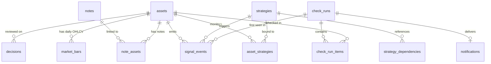

# 012 v1.0 标的中心化数据模型与迁移方案

状态：v1.0 架构设计已通过两轮访谈确认（Q1、Q4、Q6、Q7），待视觉原型确认后按里程碑 2 实施。

## 背景与问题

截至 v0.9（SQLite `user_version = 5`），数据组织存在四个结构性瓶颈：

1. **巨型 JSON 冗余**：`reports.payload` 将每次检查的全部标的 × 数百根日 K 线 + 指标序列 + 策略结果整包写入单列 TEXT，同一根历史日 K 被重复存储数百次，查询最新有效行情不得不做全表 `json_each` 扫描。
2. **双轨存储与隐式建表**：正式行情存于 `reports.payload`，工作台探索行情存于 `workspace_quotes`；`workspace_quotes` 与 `chart_templates` 甚至不在 `storage.initialize()` 的 schema 迁移中，而是散落在 `workspace.py` 懒建表。
3. **半关系化配置与目录分裂**：`current_assets` 的核心属性（代码、数据源、市场、自选状态、启停）仍埋在 `metadata TEXT` JSON 内；预设标的目录分散在 `watchlist.json`、`workspace.py` 的 `OBSERVATION_CATALOG` 和 `watchlist.mjs` 的 `EXTRA_ALIASES` 三处。
4. **领域实体孤立**：`events` 仅存拼接字符串 `key` 无法按标的/策略/日期查询；`decisions` 绑死在单份 `report_id` 下无法形成标的跨日复盘流；`investment_notes` 与标的完全脱节。

## 决策：SQLite Schema v6（标的中心化规范模型）

保留单文件 SQLite（`~/Library/Application Support/ChanceTrack/data/chance-track.sqlite3`，开启 `PRAGMA foreign_keys = ON` 与 `WAL` 模式），将全部领域实体拆分为职责单一、有显式列与索引的关系表。

### 核心实体关系



### 表结构定义

#### 1. `assets`（观察标的，一等实体）
```sql
CREATE TABLE assets (
  id TEXT PRIMARY KEY NOT NULL,
  label TEXT NOT NULL,
  ticker TEXT NOT NULL DEFAULT '',
  code TEXT NOT NULL,
  provider TEXT NOT NULL,
  kind TEXT NOT NULL CHECK (kind IN ('index', 'etf', 'spot')),
  session_profile TEXT NOT NULL,
  market TEXT NOT NULL DEFAULT '',
  currency TEXT NOT NULL DEFAULT '',
  group_name TEXT NOT NULL DEFAULT '未分组',
  secid TEXT,
  expected_name TEXT,
  enabled INTEGER NOT NULL DEFAULT 1,
  archived INTEGER NOT NULL DEFAULT 0,
  watchlisted INTEGER NOT NULL DEFAULT 1,
  priority INTEGER NOT NULL DEFAULT 0,
  position INTEGER NOT NULL UNIQUE,
  aliases_json TEXT NOT NULL DEFAULT '[]',
  fallbacks_json TEXT NOT NULL DEFAULT '[]',
  created_at TEXT NOT NULL,
  updated_at TEXT NOT NULL
);
```
- 仓库根统一维护单一 `catalog.json` 作为全部预设标的（含指数、ETF 与全部搜索别名）的唯一真源，替代原 `watchlist.json` + `OBSERVATION_CATALOG` + `EXTRA_ALIASES`。

#### 2. `market_bars`（规范化日线 OHLCV，全库去重）
```sql
CREATE TABLE market_bars (
  asset_id TEXT NOT NULL REFERENCES assets(id) ON DELETE CASCADE,
  bar_date TEXT NOT NULL,
  open REAL NOT NULL,
  high REAL NOT NULL,
  low REAL NOT NULL,
  close REAL NOT NULL,
  volume REAL,
  volume_unit TEXT,
  volume_multiplier REAL,
  quote_currency TEXT,
  is_provisional INTEGER NOT NULL DEFAULT 0,
  provider TEXT NOT NULL,
  fetched_at TEXT NOT NULL,
  source_run_id INTEGER REFERENCES check_runs(id) ON DELETE SET NULL,
  PRIMARY KEY (asset_id, bar_date)
);
CREATE INDEX idx_market_bars_asset_date ON market_bars(asset_id, bar_date DESC);
```
- 历史已完成日线（`is_provisional = 0`）按 `(asset_id, bar_date)` 唯一存储；盘中抓取仅更新最新一根 `is_provisional = 1`，收盘缓冲后重新抓取原地覆写为 `is_provisional = 0`。
- 指标序列（MACD、MA、布林带、唐奇安、RSI、周线聚合）全部由纯计算引擎从 `market_bars` 实时派生，不再冗余入库。
- 彻底废弃 `workspace_quotes`：工作台添加新标的或手动刷行情时，经校验的真实 OHLCV 直接写入 `market_bars`。

#### 3. `strategies`、`asset_strategies`、`strategy_dependencies`、`config_meta`
```sql
CREATE TABLE config_meta (
  singleton INTEGER PRIMARY KEY CHECK (singleton = 1),
  version INTEGER NOT NULL DEFAULT 1,
  updated_at TEXT NOT NULL
);

CREATE TABLE strategies (
  id TEXT PRIMARY KEY NOT NULL,
  kind TEXT NOT NULL,
  name TEXT NOT NULL,
  group_name TEXT NOT NULL DEFAULT '未分组',
  revision INTEGER NOT NULL DEFAULT 1,
  params_json TEXT NOT NULL DEFAULT '{}',
  filter_mode TEXT,
  position INTEGER NOT NULL UNIQUE,
  created_at TEXT NOT NULL,
  updated_at TEXT NOT NULL
);

CREATE TABLE asset_strategies (
  asset_id TEXT NOT NULL REFERENCES assets(id) ON DELETE CASCADE,
  strategy_id TEXT NOT NULL REFERENCES strategies(id) ON DELETE RESTRICT,
  position INTEGER NOT NULL,
  activated_at TEXT,
  PRIMARY KEY (asset_id, strategy_id),
  UNIQUE (asset_id, position)
);

CREATE TABLE strategy_dependencies (
  owner_id TEXT NOT NULL REFERENCES strategies(id) ON DELETE CASCADE,
  role TEXT NOT NULL CHECK (role IN ('trigger', 'band')),
  target_id TEXT NOT NULL REFERENCES strategies(id) ON DELETE RESTRICT,
  PRIMARY KEY (owner_id, role)
);
```
- 延续 `011-monitoring-configuration-upgrade.md` 的全部规则并发控制（乐观锁 `config_meta.version`）、`revision` 语义、等价合并与 `activated_at` 生效边界。

#### 4. `check_runs`、`check_run_items`、`notifications`（轻量检查批次与通知）
```sql
CREATE TABLE check_runs (
  id INTEGER PRIMARY KEY AUTOINCREMENT,
  day TEXT NOT NULL,
  kind TEXT NOT NULL CHECK (kind IN ('scheduled', 'manual')),
  attempt INTEGER NOT NULL DEFAULT 1,
  parent_run_id INTEGER REFERENCES check_runs(id) ON DELETE SET NULL,
  rule_version TEXT NOT NULL,
  config_version INTEGER NOT NULL,
  code_revision TEXT NOT NULL DEFAULT '',
  late INTEGER NOT NULL DEFAULT 0,
  probe_order_json TEXT NOT NULL DEFAULT '{}',
  created_at TEXT NOT NULL
);
CREATE INDEX idx_check_runs_day_kind ON check_runs(day, kind, id DESC);

CREATE TABLE check_run_items (
  run_id INTEGER NOT NULL REFERENCES check_runs(id) ON DELETE CASCADE,
  asset_id TEXT NOT NULL REFERENCES assets(id) ON DELETE CASCADE,
  status TEXT NOT NULL CHECK (status IN ('ok', 'warning', 'error', 'disabled')),
  bar_date TEXT,
  close REAL,
  is_provisional INTEGER NOT NULL DEFAULT 0,
  provider TEXT,
  fetched_at TEXT,
  carried_forward INTEGER NOT NULL DEFAULT 0,
  origin_run_id INTEGER REFERENCES check_runs(id) ON DELETE SET NULL,
  error TEXT,
  fetch_meta_json TEXT NOT NULL DEFAULT '{}',
  PRIMARY KEY (run_id, asset_id)
);

CREATE TABLE notifications (
  run_id INTEGER PRIMARY KEY REFERENCES check_runs(id) ON DELETE CASCADE,
  sent_at TEXT,
  error TEXT,
  message TEXT
);
```

#### 5. `signal_events`（结构化信号事件流 + 通知去重）
```sql
CREATE TABLE signal_events (
  id INTEGER PRIMARY KEY AUTOINCREMENT,
  dedup_key TEXT NOT NULL UNIQUE,
  asset_id TEXT NOT NULL REFERENCES assets(id) ON DELETE CASCADE,
  strategy_id TEXT,
  strategy_name TEXT NOT NULL,
  strategy_group TEXT NOT NULL DEFAULT '',
  strategy_version TEXT NOT NULL,
  event_date TEXT NOT NULL,
  event_kind TEXT NOT NULL,
  detail TEXT NOT NULL DEFAULT '',
  is_provisional INTEGER NOT NULL DEFAULT 0,
  historical_reference INTEGER NOT NULL DEFAULT 0,
  first_run_id INTEGER REFERENCES check_runs(id) ON DELETE SET NULL,
  notified_at TEXT,
  notified_run_id INTEGER REFERENCES check_runs(id) ON DELETE SET NULL,
  created_at TEXT NOT NULL
);
CREATE INDEX idx_signal_events_asset_date ON signal_events(asset_id, event_date DESC);
CREATE INDEX idx_signal_events_date ON signal_events(event_date DESC, id DESC);
```
- `dedup_key` 保持与历史完全兼容的格式（`{asset_id}:{event_date}:{strategy_version}:{event_kind}`），确保升级后**绝不重复补发历史通知**。
- 盘中暂态事件（`is_provisional = 1`）不写永久 `notified_at`，只在当次检查结果中展示为「盘中待确认」。

#### 6. `decisions`（标的复盘决策时间线）
```sql
CREATE TABLE decisions (
  id INTEGER PRIMARY KEY AUTOINCREMENT,
  asset_id TEXT NOT NULL REFERENCES assets(id) ON DELETE CASCADE,
  run_id INTEGER REFERENCES check_runs(id) ON DELETE SET NULL,
  bar_date TEXT NOT NULL,
  price_at_decision REAL,
  action TEXT NOT NULL CHECK (action IN ('买入', '卖出', '持有', '观望')),
  execution TEXT NOT NULL CHECK (execution IN ('未执行', '已提交')),
  note TEXT NOT NULL DEFAULT '',
  evidence_json TEXT,
  created_at TEXT NOT NULL
);
CREATE INDEX idx_decisions_asset_date ON decisions(asset_id, bar_date DESC, id DESC);
```
- 决策直接挂在 `asset_id` + `bar_date` 下，支持跨时间线检索与在 K 线图上叠加显示；`evidence_json` 保存用户显式选择的探索参数、行情口径与计算快照。

#### 7. `notes`、`note_assets`、`chart_templates`
```sql
CREATE TABLE notes (
  id INTEGER PRIMARY KEY AUTOINCREMENT,
  title TEXT NOT NULL,
  markdown TEXT NOT NULL,
  pinned INTEGER NOT NULL DEFAULT 0,
  created_at TEXT NOT NULL,
  updated_at TEXT NOT NULL
);
CREATE UNIQUE INDEX idx_notes_pin ON notes(pinned) WHERE pinned = 1;

CREATE TABLE note_assets (
  note_id INTEGER NOT NULL REFERENCES notes(id) ON DELETE CASCADE,
  asset_id TEXT NOT NULL REFERENCES assets(id) ON DELETE CASCADE,
  PRIMARY KEY (note_id, asset_id)
);

CREATE TABLE chart_templates (
  id INTEGER PRIMARY KEY AUTOINCREMENT,
  template_id TEXT NOT NULL,
  name TEXT NOT NULL,
  strategies_json TEXT NOT NULL,
  created_at TEXT NOT NULL
);
CREATE INDEX idx_chart_templates_tid ON chart_templates(template_id, id DESC);
```

## 无损迁移策略（Schema v5 → v6）

遵循 `install_launchd.py` 既有的「先备份 → 隔离临时副本预演校验 → 通过后再切运行库」原则：

1. **备份与恢复包**：升级前自动生成 `backups/v09-to-v10-<timestamp>/`，包含原 v5 数据库一致性副本（`PRAGMA quick_check = ok`）与旧程序 `runtime-revision.txt`。
2. **数据无损映射**：
   - `current_assets` + `current_strategies` + `monitoring_bindings` + `combination_references` → `assets` + `strategies` + `asset_strategies` + `strategy_dependencies` + `config_meta`。
   - 从历史 `reports.payload`（按 `id ASC` 重放，仅取 `snapshot.basis = 'market_ohlc'`）提取全部真实 OHLCV 日线，去重覆写进 `market_bars`（每个 `(asset_id, bar_date)` 保留最新确认值），同步保留最近检查批次摘要到 `check_runs` / `check_run_items` 与 `notifications`。
   - `events` 与 `notification_events` → 迁移为 `signal_events`（保留原始 `dedup_key` 与 `notified_at`，保证零重复通知）。
   - `decisions` + `decision_contexts` → 迁移至新 `decisions`（从关联历史报告自动补全 `bar_date` 与当时 `close` 价，完整保留 `evidence_json`）。
   - `investment_notes` → 迁移至 `notes`（保留置顶状态与时间戳）。
   - `chart_templates` → 迁移至新 `chart_templates`。
3. **停止背负的历史兼容**：迁移完成后，v1.0 运行代码不再包含 v0.4 基金净值展示分支、旧版 SSR HTML 表单路由和旧配置逐版本回放 UI；极端审计需求可随时从归档的 v5 备份库只读查阅。

## v1.0 JSON API 契约（FastAPI）

所有前端交互通过统一的 `/api/v1/*` JSON 接口完成，写操作继续使用本机 CSRF Token 保护（`X-CSRF-Token` 请求头），服务端仍只监听 `127.0.0.1:8765`：

- 定时自动重试（14:35 起 5 分钟间隔、最多 3 次、15:00 截止）在出现单标的采集失败（`status = 'error'`）或相对强弱基准失败（`fetch_meta_json.failed_benchmark = true`）时触发；已成功的标的从 `market_bars` 复用当日行情，重试始终基于当前生效配置与未归档观察列表执行。

| 端点 | 方法 | 职责 |
| --- | --- | --- |
| `/api/v1/bootstrap` | `GET` | 启动态：CSRF token、配置版本、全量标的列表（含最新价/涨跌幅/状态/事件计数）、策略库、模板、置顶备忘、下次自动检查时间、当前检查运行态 |
| `/api/v1/catalog` | `GET` | 检索统一预设目录 `catalog.json`（支持名称、代码、别名） |
| `/api/v1/assets` | `POST` | 从目录加入或手动添加标的（启用前联网校验真实行情并将日线入库 `market_bars`） |
| `/api/v1/assets/{id}` | `PATCH` | 更新名称、分组、启停、归档、自选、重点关注 |
| `/api/v1/assets/order` | `PUT` | 批量更新自选标的顺序 |
| `/api/v1/assets/{id}/bars` | `GET` | 读取规范化日线 + 当前绑定策略的指标图层、带 `date`/`direction` 的策略事件与该标的历史决策标记（周线视图由前端聚合） |
| `/api/v1/assets/{id}/quote` | `POST` | 单标的即时拉取最新行情并写入 `market_bars` |
| `/api/v1/assets/{id}/preview` | `POST` | 基于 `market_bars` 纯计算临时探索指标与信号，零写入、零网络请求 |
| `/api/v1/assets/{id}/monitoring` | `PUT` | 绑定/解绑/新建/共享更新该标的的自动监测策略（携带乐观锁版本，返回受影响标的） |
| `/api/v1/assets/{id}/decisions` | `GET` / `POST` | 读取该标的跨时间线决策 / 追加保存新决策（校验 ISO 日期与有限价格，含可选探索依据重算存证） |
| `/api/v1/decisions/{id}/evidence` | `GET` | 读取某条决策关联的独立探索依据快照 |
| `/api/v1/runs` | `GET` / `POST` | 查询近期检查批次与通知状态 / 触发立即检查（支持同步或 `async: true`） |
| `/api/v1/runs/{id}` | `GET` | 查询单次检查批次详情与各标的结果 |
| `/api/v1/signals` | `GET` | 跨标的信号流与准确总数 `total`（支持按 `asset_id` / `strategy_id` / `limit` 查询） |
| `/api/v1/strategies` | `GET` / `POST` | 规则库查询与 `op=upsert|delete|merge` 维护（携带乐观锁版本号） |
| `/api/v1/templates` | `GET` / `POST` | 指标模板列表与版本化保存 |
| `/api/v1/notes` | `GET` / `POST` | 备忘录列表（支持按 `asset_id` 筛选）与新建 |
| `/api/v1/notes/{id}` | `GET` / `PATCH` / `DELETE` | 读、改（含更新关联标的、保留未传标题、支持 `updated_at` 乐观锁）、删（支持 `updated_at` 乐观锁） |
| `/api/v1/notes/{id}/pin` | `POST` | 设为全局置顶备忘 |
| `/api/runtime-health` | `GET` | 保持兼容，供 `install_launchd.py` 验收运行副本 SHA |
